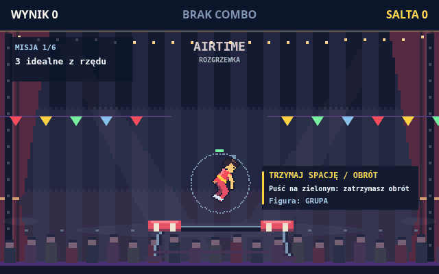

# Airtime

Akrobatyczna gra na trampolinie — obracaj się w powietrzu, zmieniaj figury i ląduj na pionie.

[Zagraj](https://www.gamedev.pl/play/airtime) · [Studio](https://www.gamedev.pl/studio/airtime)

## Układ repozytorium

- `src/` — komplet źródeł gry i metadanych wymaganych przez platformę.
- `scripts/` — deployment, synchronizacja, verify i wydania.
- `docs/media/` — animowany podgląd rozgrywki.
- `CHANGELOG.md` i `VERSION` — historia i numer wydania.

## Deployment

Push taga `preview-*` albo ręczne uruchomienie workflow **Deploy Airtime preview**
wysyła źródła do Gamedev.pl i uruchamia build podglądu. Platforma wykonuje typecheck,
smoke i build; wynik oraz podgląd są w Studio. Zielony workflow oznacza przyjęcie
źródeł i uruchomienie buildu, a nie zakończenie jego weryfikacji.

1. W [połączeniu twórcy w Studio](https://www.gamedev.pl/studio/airtime/connect)
   utwórz personal access token (PAT) do CI.
2. Dodaj go w [sekretach Actions](https://github.com/gtanczyk/airtime/settings/secrets/actions)
   jako **GAMEDEV_CREATOR_KEY** (nazwa pozostała dla zgodności; wartością jest PAT). Nie zapisuj go w plikach ani commitach.
3. Uruchom workflow w zakładce Actions.

Workflow aktualizuje podgląd w Studio. Publiczna wersja gry wymaga osobnej publikacji
i pełnej weryfikacji; stare `TRACE.json` i `PLAYTEST.json` nie są dowodem dla nowych zmian.
Nie edytuj równolegle tej samej rundy w Studio i w CI. Gdy Studio zgłasza stop lub ma
oczekujące wiadomości twórcy, workflow przerywa pracę.

`index.html` jest zachowaną stroną źródłowej wersji. Aktualna platforma generuje stronę
z `GAME.json.howToPlay`; workflow nie wysyła `index.html` ani konfiguracji repozytorium.

## Uruchomienie lokalne

Wymagany Node.js 22 lub nowszy.

```sh
npm install
npm run dev
```

Przy pierwszym uruchomieniu potrzebny jest PAT z [Studio](https://www.gamedev.pl/studio/airtime/connect).
Zapisz go lokalnie w ignorowanym pliku `.env`:

```dotenv
GAMEDEV_PAT=twój_personal_access_token
```

Skrypt pobiera oficjalny Creator Kit do `.gamedev/local/`, instaluje jego zależności
i otwiera lokalny podgląd przez gamedevpl CLI. Po przygotowaniu środowiska PAT nie
jest potrzebny do kolejnych uruchomień. Zmiany w `src/` odświeżają podgląd;
Ctrl+C zatrzymuje serwer. Uruchomienie nie wysyła zmian do Studio.

`npm run verify` wykonuje typecheck i sprawdzenia statyczne na tych samych źródłach.
`npm run verify:sources` sprawdza paczkę bez pobierania silnika.

## Wydania z CHANGELOG.md

Zmiany opisuj w sekcji `Unreleased`:

```md
## Unreleased

### Added
- Nowa figura akrobatyczna.

### Fixed
- Poprawiono naliczanie combo.
```

Po pushu do master workflow **Airtime release PR** otwiera lub aktualizuje jeden PR
`release/airtime`. Wersja wynika z kategorii: Breaking → major, Added → minor,
Fixed → patch. Same wpisy Internal nie tworzą wydania. Startowa wersja 0.1.0 jest
punktem odniesienia; nie uruchamia automatycznego deploymentu.

Ty decydujesz, kiedy wydać: scal PR wydania. Workflow **Airtime release** wysyła
podgląd do Studio, tworzy tag `airtime-vX.Y.Z` i GitHub Release z opisem z changeloga.
Akceptacja wysyłki nie oznacza, że build przeszedł weryfikację — wynik jest w Studio.
Publiczna publikacja gry pozostaje osobnym krokiem.

Nie trzeba ręcznie tworzyć tagów. Starszy workflow z tagami `preview-*` pozostaje
dostępny do próbnych wdrożeń bez wydania. Ponowienie workflow istniejącego GitHub
Release pomija deployment. Scalenie Release PR powinno wykonać konto użytkownika;
scalenie automatyzacją z GITHUB_TOKEN nie uruchamia kolejnego workflow.

## Gamedev.pl → GitHub

Workflow **Sync sources from Gamedev.pl** sprawdza źródła co godzinę lub ręcznie.
Różnice tworzą albo aktualizują PR `sync/gamedev`, także usunięcia plików gry.
Nie nadpisuje workflow, skryptów, dokumentacji ani licencji. Pomija aktywnego agenta
i niezapisane edycje. Importowany podgląd nie musi mieć pozytywnego wyniku buildu.
Przejrzyj PR: platforma może zastąpić zmiany repo, których jeszcze nie wdrożono.

Scalenie synchronizacji samo nie wdraża gry. Dopisz zmiany do Unreleased, jeśli
chcesz uwzględnić je w kolejnym wydaniu.

Oba workflow tworzące PR wymagają w Settings → Actions → General opcji
**Allow GitHub Actions to create and approve pull requests**.
